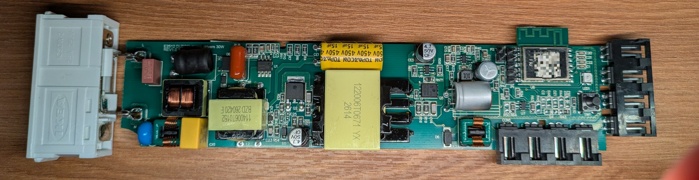

# dubbelkisel-teardown

Teardown of the IKEA DUBBELKISEL.

> [!NOTE]
> **Work in progress.** These findings come from hands-on work with a real device and may change as the teardown continues. The documentation is written with help from [Claude](https://claude.com/claude-code).

## Status

**Done:**

- PCB inspection
- SWD and serial pinouts
- Boot log and CLI

**Still open:**

- Exact SoC part
- Firmware dump
- Output voltage and dimming method

## Key findings

- All 8 outputs are wired in parallel and switched by a single FET, so they can only be switched together.
- The radio is a module with a PCB antenna. Its shield can carries a QR code that repeats the casing QR data plus extra digits.
- A full SWD header is broken out on a 5-way 0.1" header.
- A 2-pin serial header (TX/RX, 115200 baud, 3.3 V) gives boot messages and a CLI.
- Matter over Thread (Thread router), with BLE for commissioning, on the Silicon Labs Matter SDK.
- A single Matter light endpoint with On/Off and Level Control.

<!-- TODO: exact SoC, firmware dump -->

## Documentation

| Doc | Contents |
| --- | --- |
| [Hardware](docs/hardware.md) | Enclosure, opening the device, PCB, BOM, power |
| [Pinout](docs/pinout.md) | Test points, debug headers, traced connections |
| [Firmware](docs/firmware.md) | MCU/SoC, flash, dumping, boot logs, OTA |
| [Radio](docs/radio.md) | Protocol, pairing behaviour, captures |
| [Hacking](docs/hacking.md) | Custom firmware and Home Assistant integration options |

## Disclaimer

Opening the device voids the warranty. Do this at your own risk.

## License

[MIT](LICENSE)
