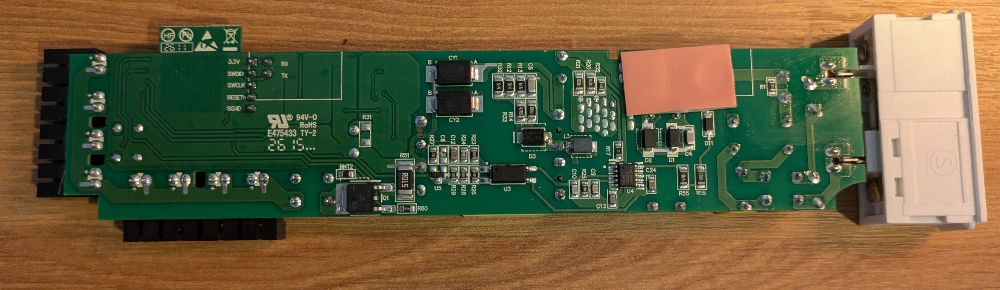
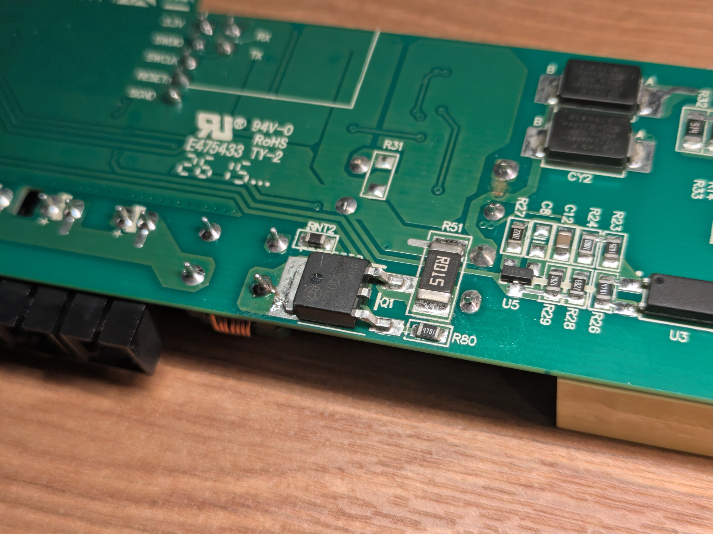

# Hardware

## Opening the device

<!-- TODO: tools needed, clips/screws, photos -->

## PCB overview

The silkscreen identifies the board as `E2512 DUBBELKISEL drivers 30W`, revision `REV1.0.3`.

*Top side. The QR code on the wireless module has been pixelated.*

*Bottom side, showing the SWD and serial headers on the left.*

<!-- TODO: annotations -->

### Outputs

The 8 outputs are wired in parallel and driven by a single switching FET. They cannot be controlled individually; they all switch on and off together.

The FET (Q1, DPAK package, on the bottom side) is marked `LT1000N04`. Next to it is R51, marked `R015`, which is probably a 15 mΩ current-sense resistor.

<!-- TODO: confirm manufacturer/datasheet, gate drive, output voltage -->

### Wireless module

The device uses a module with a PCB antenna. The module's shield can is marked with a QR code. It decodes to the same data as the QR code on the outside of the casing, followed by a semicolon and some extra digits.

<!-- TODO: module/SoC identity, photo -->

### Debug header

A full SWD header is broken out on a 5-way 0.1" header. There is also a separate 2-pin serial header. See [Pinout](pinout.md#debug-interfaces).

## Bill of materials

| Ref | Markings | Part | Function |
| --- | --- | --- | --- |
| <!-- TODO --> | `LT1000N04` | <!-- TODO --> | Output switching FET |
| <!-- TODO --> | | | |

## Power

<!-- TODO: supply/battery, regulators, measured current draw -->
